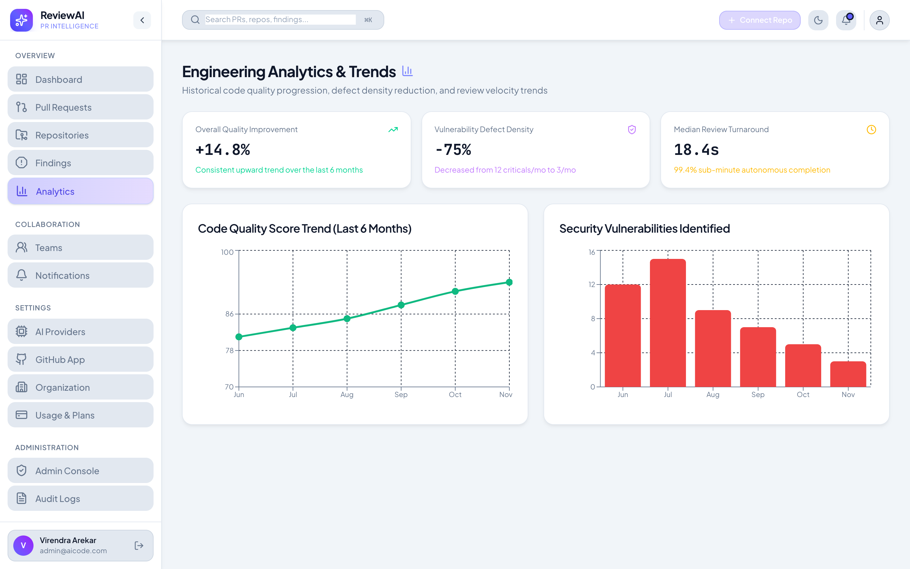
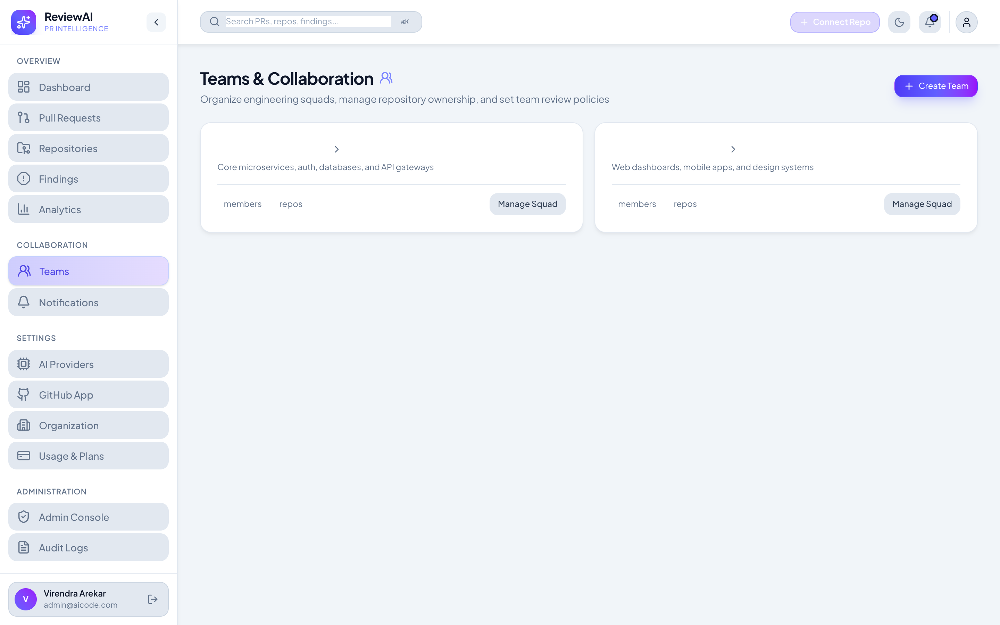
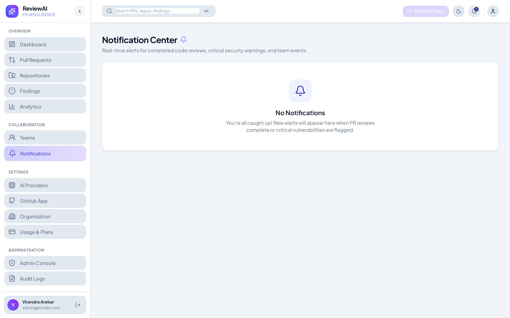
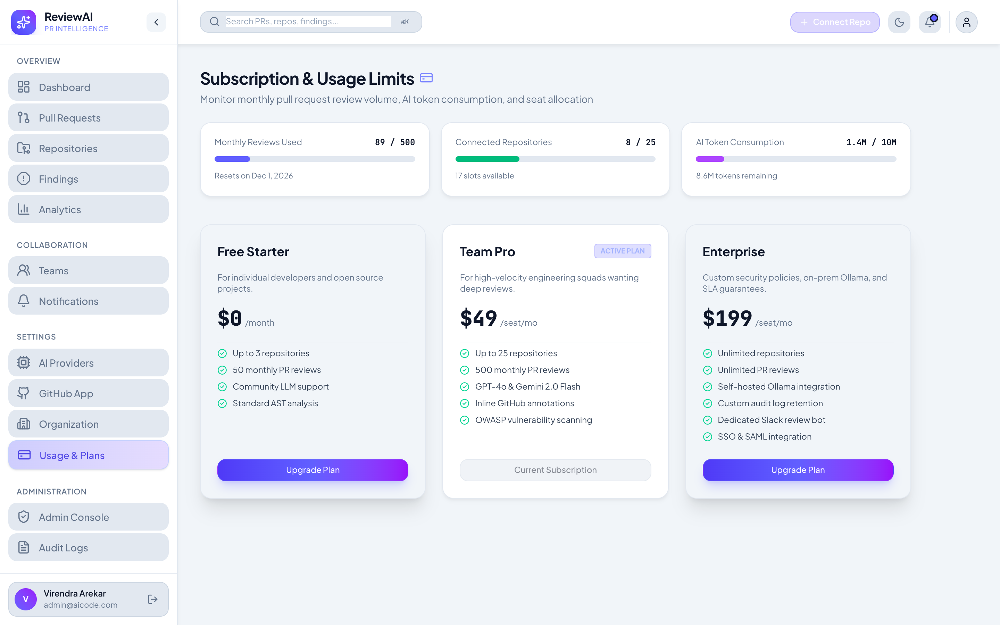

# AI Code Reviewer for Pull Requests 🚀

[](https://github.com/VirendraArekar/ai-code-reviewer/actions)
[](https://opensource.org/licenses/MIT)
[](https://openjdk.org/)
[](https://spring.io/projects/spring-boot)
[](https://react.dev/)
[](https://www.typescriptlang.org/)
[](https://tailwindcss.com/)
[](https://www.mysql.com/)
[](https://www.docker.com/)

> **A production-ready SaaS application for automated GitHub Pull Request code reviews.**  
> Powered by intelligent LLM analysis and static heuristics to detect bugs, security vulnerabilities, performance bottlenecks, architecture violations, and missing test cases before merging.

---

## 🌟 Key Features

- **🐙 Complete GitHub Integration**: Automatic PR review triggers on `pull_request.opened` / `synchronize` webhooks, GitHub Checks API integration, and automated inline review comments directly on pull requests.
- **🤖 Multi-LLM Provider Abstraction**: Unified support for **Google Gemini** (Gemini 2.0 / 2.5 Flash & Pro), **OpenAI** (GPT-4o / GPT-4o-mini), and local **Ollama** models (DeepSeek-Coder, CodeLlama).
- **🔍 Deep 6-Category Automated Analysis**:
  - 🐛 **Bug Detection**: Null pointer exceptions, race conditions, memory leaks, logic bugs, boundary overflows.
  - 🛡️ **Security Vulnerabilities**: OWASP Top 10, SQL injection, XSS, CSRF, IDOR, hardcoded secrets, SSRF, path traversal.
  - ⚡ **Performance Optimization**: N+1 queries, memory consumption, expensive iterations, missing caching.
  - 🧹 **Code Quality & Smells**: SOLID violations, cyclomatic complexity, DRY violations, dead code.
  - 🏛️ **Architecture & Design**: Coupling issues, circular dependencies, domain layer violations.
  - 🧪 **Testing Analysis**: Missing unit/integration tests, insufficient edge-case coverage, mock verification.
- **💻 Interactive Monaco Diff Viewer**: Unified and side-by-side diff review with inline severity badges, code annotations, and one-click recommended fixes.
- **💬 Contextual AI PR Chat Assistant**: Interactive chatbot allowing engineers to ask specific questions about pull request diffs, code logic, or remediation steps.
- **📊 Real-Time Analytics & Quality Scoring**: Real MySQL-persisted metrics for code health, review velocity, severity distribution, and team trends.
- **🏢 Enterprise Security & RBAC**: Role-based access control (Super Admin, Admin, Org Owner, Team Lead, Developer, Viewer), AES-256 encrypted tokens, and HMAC webhook signature validation.

---

## 📸 Application Screenshots

### ☀️ Light Mode Screens (2 screens per row)

| **01. Dashboard Overview** | **02. Connected Repositories** |
| :---: | :---: |
| [](./docs/images/01-dashboard-light.png) | [](./docs/images/02-repositories-light.png) |

| **03. Pull Requests Hub** | **04. Pull Request Review & Diff** |
| :---: | :---: |
| [](./docs/images/03-pull-requests-light.png) | [](./docs/images/03b-pull-request-detail-light.png) |

| **05. Findings & Vulnerabilities** | **06. Real-Time Analytics & Scoring** |
| :---: | :---: |
| [](./docs/images/04-findings-light.png) | [](./docs/images/05-analytics-light.png) |

| **07. Engineering Teams** | **08. AI Provider Configurations** |
| :---: | :---: |
| [](./docs/images/06-teams-light.png) | [](./docs/images/07-ai-providers-light.png) |

| **09. GitHub App & Webhook Integration** | **10. Notification Center** |
| :---: | :---: |
| [](./docs/images/08-github-integration-light.png) | [](./docs/images/09-notifications-light.png) |

| **11. Security Audit Logs** | **12. Organization Settings** |
| :---: | :---: |
| [](./docs/images/10-audit-logs-light.png) | [](./docs/images/11-organization-light.png) |

| **13. Usage & Billing Plans** | |
| :---: | :---: |
| [](./docs/images/12-billing-light.png) | |

---

### 🌙 Dark Mode Preview (Findings & Vulnerabilities Screen)

| **Dark Mode: Review Findings & Vulnerabilities Hub** |
| :---: |
| [](./docs/images/findings-dark.png) |

---

## 🏗️ System Architecture

```
                       +------------------------------------------+
                       |         GitHub Developer Platform        |
                       |  (Webhooks / Checks API / Reviews / App) |
                       +--------------------+---------------------+
                                            |  Webhooks / API
                                            v
+------------------+         +----------------------------+         +---------------------+
|   React + Vite   | <=====> |    Spring Boot 3.4 / 4     | <=====> |   MySQL 8+ Database |
| Tailwind v4 + TS | (REST)  |  (Java Modular Backend)    |  (JPA)  | (Flyway Migrations) |
+------------------+         +--------------+-------------+         +---------------------+
                                            |
                                            v
                             +----------------------------+
                             |   AI Provider Abstraction  |
                             |  (OpenAI / Gemini / Ollama)|
                             +----------------------------+
```

---

## 💻 Tech Stack

| Layer | Technologies |
| :--- | :--- |
| **Frontend** | React 19, TypeScript, Vite, Redux Toolkit, RTK Query, Tailwind CSS v4, Monaco Editor, Lucide Icons, Recharts, Sonner Notifications |
| **Backend** | Java 21+, Spring Boot 3.4+, Spring Security, Spring Data JPA, Spring AI, Lombok, MapStruct, Maven |
| **Database** | MySQL 8+, Hibernate 6, HikariCP, Flyway Migrations |
| **AI Providers** | Google Gemini (2.0/2.5 Flash & Pro), OpenAI (GPT-4o), Ollama (DeepSeek-Coder) |
| **GitHub Integration** | GitHub Apps API, Webhooks, GitHub REST & Checks API, Octokit specifications |
| **DevOps & Testing** | Docker, Docker Compose, JUnit 5, Mockito, Vitest, React Testing Library |

---

## 🚀 Quick Start (Docker Compose)

The fastest way to launch the entire stack (Frontend, Backend, MySQL, and Ollama):

```bash
# 1. Clone repository
git clone https://github.com/VirendraArekar/ai-code-reviewer.git
cd ai-code-reviewer

# 2. Copy and customize environment variables
cp .env.example .env

# 3. Start all services
docker compose up -d --build
```

### Access URLs:
- **Frontend Application**: `http://localhost:3000`
- **Backend REST API**: `http://localhost:8080/api/v1`
- **Swagger OpenAPI Docs**: `http://localhost:8080/swagger-ui.html`
- **Actuator Health Check**: `http://localhost:8080/actuator/health`

### Default Seed Credentials:
- **Email**: `admin@aicode.com`
- **Password**: `AdminPassword123!`

---

## 🛠️ Local Development Setup

If you prefer running services directly on your host machine:

### 1. Database
```bash
mysql -u root -p -e "CREATE DATABASE aicode_reviewer CHARACTER SET utf8mb4 COLLATE utf8mb4_unicode_ci;"
```

### 2. Backend (Spring Boot)
```bash
cd backend
mvn clean install -DskipTests
mvn spring-boot:run
```

### 3. Frontend (React + Vite)
```bash
cd frontend
npm install
npm run dev
```
Development frontend runs at `http://localhost:5173`.

---

## ⚙️ Environment Configuration (`.env`)

```ini
# Database Configuration
MYSQL_HOST=localhost
MYSQL_PORT=3306
MYSQL_DATABASE=aicode_reviewer
MYSQL_USER=aicode_user
MYSQL_PASSWORD=aicode_password

# JWT Security
APP_JWT_SECRET=404E635266556A586E3272357538782F413F4428472B4B6250645367566B5970
APP_JWT_ACCESS_EXPIRATION_MS=3600000
APP_SECURITY_ENCRYPTION_KEY=5v8x/A?D(G+KbPeShVmYq3t6w9z$B&E)

# GitHub App Integration
GITHUB_APP_ID=
GITHUB_APP_NAME=ai-code-reviewer
GITHUB_APP_CLIENT_ID=
GITHUB_APP_CLIENT_SECRET=
GITHUB_WEBHOOK_SECRET=your_webhook_secret

# AI Providers (Optional - can also be configured dynamically in UI)
GEMINI_API_KEY=
OPENAI_API_KEY=
OLLAMA_BASE_URL=http://localhost:11434
```

---

## 🧪 Testing

```bash
# Run all backend unit & integration tests
mvn -f backend/pom.xml test

# Run frontend Vitest suite
cd frontend && npm run test
```

---

## 📄 License

This project is licensed under the MIT License - see the [LICENSE](LICENSE) file for details.
