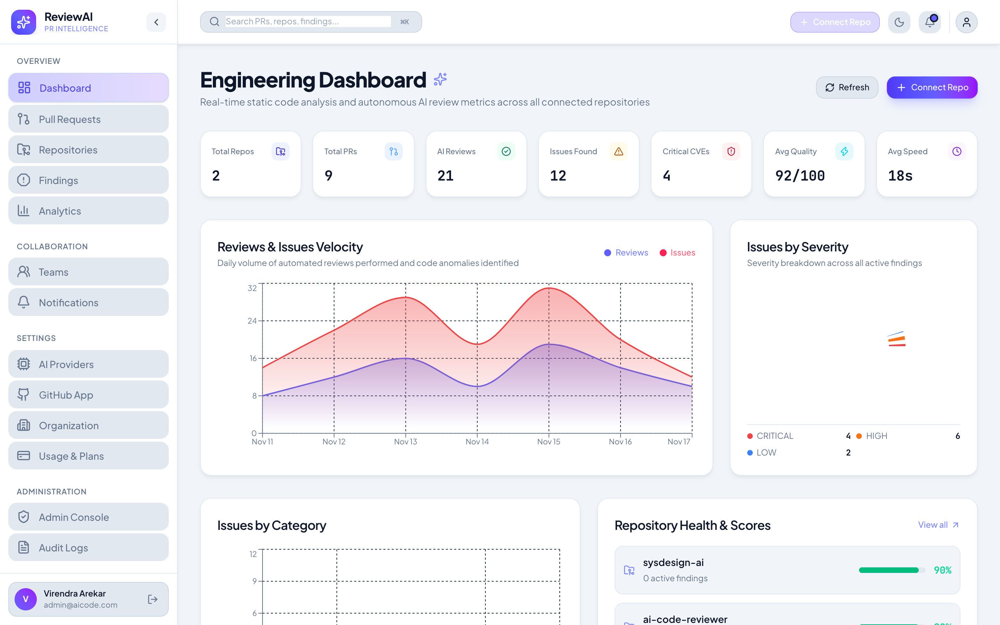
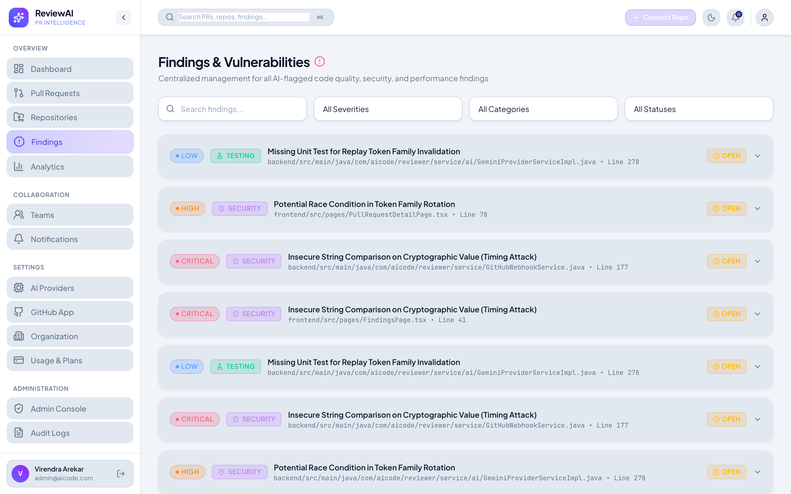
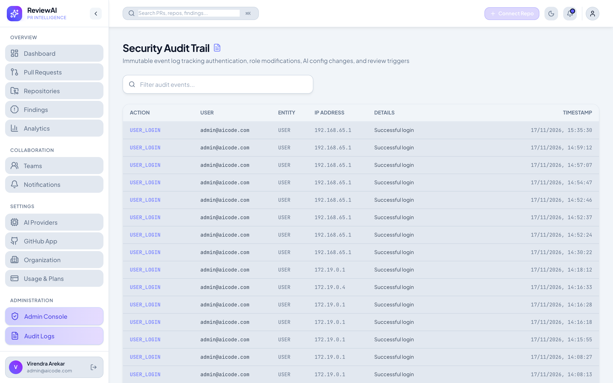
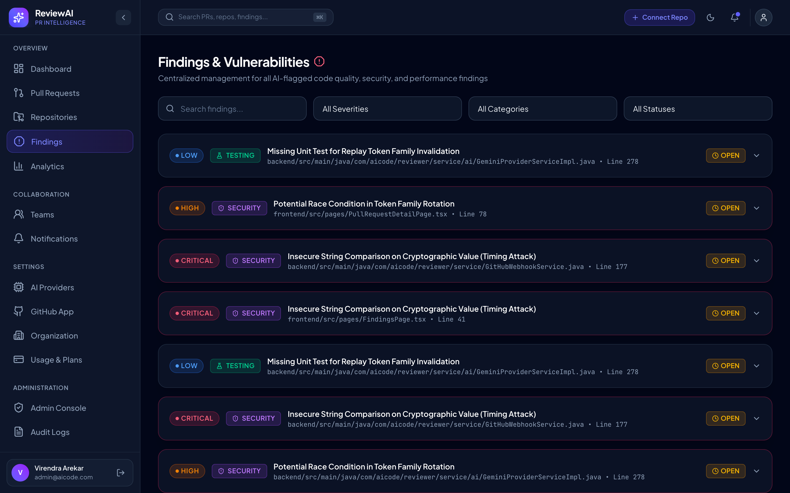

# AI Code Reviewer for Pull Requests 🚀

[](https://github.com/VirendraArekar/ai-code-reviewer/actions)
[](https://opensource.org/licenses/MIT)
[](https://openjdk.org/)
[](https://spring.io/projects/spring-boot)
[](https://react.dev/)
[](https://www.typescriptlang.org/)
[](https://tailwindcss.com/)
[](https://www.mysql.com/)

> Production-ready, enterprise-grade AI-powered GitHub Pull Request code review platform. Automatically analyzes code changes using LLM intelligence and static heuristics to detect bugs, security vulnerabilities, performance bottlenecks, architecture violations, code smells, and missing test cases before merging.

---

## 🌟 Key Features

- **Automated GitHub PR Reviews**: Seamless integration with GitHub Webhooks, GitHub Apps, GitHub Checks API, and inline review comments.
- **Multi-LLM Provider Abstraction**: Native support for OpenAI (GPT-4o / GPT-4o-mini), Google Gemini (Gemini 2.5/2.0 Flash & Pro), and local Ollama models (DeepSeek-Coder, Llama 3, CodeLlama).
- **Intelligent Diff Analysis & Chunking**: Syntax-aware diff parser supporting Java, TypeScript, JavaScript, Python, Go, PHP, C#, Kotlin, SQL, HTML, and CSS.
- **Deep 6-Category Review Engine**:
  - 🐛 **Bug Detection**: Null pointer exceptions, race conditions, memory leaks, logic bugs, boundary errors.
  - 🛡️ **Security Vulnerabilities**: OWASP Top 10, SQLi, XSS, CSRF, IDOR, hardcoded secrets, SSRF, path traversal.
  - ⚡ **Performance Optimization**: N+1 queries, high memory complexity, excessive loops, unmemoized renders.
  - 🧹 **Code Quality & Smells**: SOLID principles, cyclomatic complexity, DRY violations, dead code.
  - 🏛️ **Architecture & Design**: Layer violations, circular dependencies, tight coupling.
  - 🧪 **Test Coverage Analysis**: Edge cases, missing unit/integration tests, mocking suggestions.
- **Interactive Monaco Diff Viewer**: Unified and split side-by-side diff review with inline severity badges, code annotations, and one-click fixes.
- **AI PR Chat Assistant**: Contextual chatbot allowing developers to ask questions about specific pull requests, line changes, or suggested fixes.
- **Real-Time Analytics & Dashboard**: Real MySQL-driven statistics for review velocity, severity distributions, code quality trends, and team productivity.
- **Enterprise Security & Compliance**: Strict RBAC (Super Admin, Admin, Org Owner, Team Lead, Developer, Viewer), AES-256-GCM token encryption, JWT with refresh token rotation, and HMAC webhook signature verification.

---

## 📸 Application Screenshots

### ☀️ Light Mode Screens (2 screens per line)

| Dashboard Overview | Repositories Management |
| :---: | :---: |
|  |  |

| Pull Requests Hub | Pull Request Review & Diff |
| :---: | :---: |
|  |  |

| Review Findings & Recommendations | Real-Time Analytics & Scoring |
| :---: | :---: |
|  |  |

| Engineering Teams | AI Provider Configurations |
| :---: | :---: |
|  |  |

| GitHub App & Webhook Integration | Notification Center |
| :---: | :---: |
|  |  |

| Security Audit Logs | Organization Management |
| :---: | :---: |
|  |  |

| Subscription & Usage Plans | |
| :---: | :---: |
|  | |

---

### 🌙 Dark Mode Preview (Findings Screen)

| Dark Mode: Review Findings Screen |
| :---: |
|  |

---

## 🏗️ System Architecture

The application adopts a modular monolith architecture with strictly defined bounded contexts:

```
                      +------------------------------------------+
                      |         GitHub Developer Platform        |
                      |  (Webhooks / Checks API / Reviews / App) |
                      +--------------------+---------------------+
                                           |
                                           v
+------------------+         +----------------------------+         +---------------------+
|   React + Vite   | <=====> |    Spring Boot 3.4 / 4     | <=====> |   MySQL 8+ Database |
| Tailwind v4 + TS | (REST)  |  (Java 25 Modular Backend) |  (JPA)  | (Flyway Migrations) |
+------------------+         +--------------+-------------+         +---------------------+
                                            |
                                            v
                             +----------------------------+
                             |   AI Provider Abstraction  |
                             |  (OpenAI / Gemini / Ollama)|
                             +----------------------------+
```

---

## 💻 Tech Stack

### Frontend
- **Framework**: React 19 + TypeScript + Vite
- **State Management**: Redux Toolkit + RTK Query
- **Styling**: Tailwind CSS v4 + Lucide React + Framer Motion
- **Editor**: Monaco Editor (`@monaco-editor/react`)
- **Visualizations**: Recharts
- **Forms & Validation**: React Hook Form + Zod
- **Notifications**: Sonner

### Backend
- **Platform**: Java 25 LTS
- **Framework**: Spring Boot 3.4+ / 4.x with Spring Web, Spring Security, Spring Data JPA, Actuator
- **ORM & Database**: Hibernate 6.x + HikariCP + MySQL 8+
- **Migrations**: Flyway DB migrations
- **Mapping & Utilities**: MapStruct + Lombok + Jackson

### AI Engine
- Unified Multi-Provider Engine (OpenAI, Google Gemini, Ollama)
- Temperature, token budgeting, diff-chunking, and prompt injection defense

---

## 🚀 Quick Start (Local Development)

### Prerequisites
- Java 25+
- Node.js 20+ & npm 10+
- MySQL 8.0+
- Maven 3.9+
- Docker & Docker Compose (optional)

### 1. Database Setup
```bash
# Create MySQL Database
mysql -u root -p -e "CREATE DATABASE aicode_reviewer CHARACTER SET utf8mb4 COLLATE utf8mb4_unicode_ci;"
```

### 2. Backend Setup
```bash
cd backend
mvn clean install -DskipTests
mvn spring-boot:run
```
The backend API server starts at `http://localhost:8080/api/v1`.
Swagger OpenAPI documentation is available at `http://localhost:8080/swagger-ui.html`.

### 3. Frontend Setup
```bash
cd frontend
npm install
npm run dev
```
The React development server launches at `http://localhost:5173`.

---

## 📋 Development Phases Roadmap

- [x] **Phase 1**: Repository initialization and project architecture.
- [x] **Phase 2**: React frontend initialization and design system.
- [x] **Phase 3**: Spring Boot backend initialization.
- [x] **Phase 4**: MySQL integration and Flyway migrations.
- [x] **Phase 5**: Authentication and authorization.
- [x] **Phase 6**: User profile and onboarding.
- [x] **Phase 7**: GitHub OAuth integration.
- [x] **Phase 8**: GitHub App installation.
- [x] **Phase 9**: Repository management.
- [x] **Phase 10**: Webhook processing.
- [x] **Phase 11**: Pull request retrieval and diff processing.
- [x] **Phase 12**: AI provider abstraction.
- [x] **Phase 13**: AI code review engine.
- [x] **Phase 14**: Bug and code quality detection.
- [x] **Phase 15**: Security analysis.
- [x] **Phase 16**: Performance analysis.
- [x] **Phase 17**: AI findings management.
- [x] **Phase 18**: GitHub Checks integration.
- [x] **Phase 19**: Inline review comments.
- [x] **Phase 20**: Dashboard and analytics.
- [x] **Phase 21**: Findings management.
- [x] **Phase 22**: Team collaboration.
- [x] **Phase 23**: Notifications.
- [x] **Phase 24**: Usage and subscription management.
- [x] **Phase 25**: Admin dashboard and audit logs.
- [x] **Phase 26**: Automated testing.
- [x] **Phase 27**: Security hardening and optimization.
- [x] **Phase 28**: Docker and CI/CD.
- [x] **Phase 29**: Documentation and production readiness.

---

## 📄 License
This project is licensed under the MIT License - see the [LICENSE](LICENSE) file for details.
