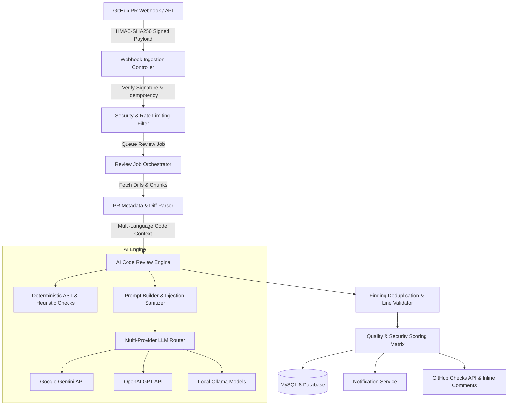

# System Architecture: AI Code Reviewer for Pull Requests

## 1. Overview & System Philosophy

**AI Code Reviewer for Pull Requests** is a commercial-grade, multi-tenant enterprise SaaS platform engineered to automate static and AI-powered code reviews on GitHub Pull Requests. It combines static AST/diff rule analysis with state-of-the-art Large Language Models (Google Gemini, OpenAI, Ollama) to identify vulnerabilities, race conditions, performance bottlenecks, and code quality issues before code lands in main branches.

---

## 2. Layered Architecture (Backend)

The backend is built as a modular monolith adhering to Clean Architecture principles:

- **Presentation / Controller Layer**:
  - `AuthController`: User registration, JWT login, refresh token rotation, password recovery.
  - `RepositoryController`: Organization repository management, sync, auto-review toggles.
  - `PullRequestController`: PR listings, diff inspection, contextual AI chat.
  - `ReviewController`: On-demand review dispatch, review summaries, scores.
  - `FindingController`: Issue inspection, category/severity filtering, status transitions, review comments.
  - `AnalyticsController`: KPI metrics, severity distribution, velocity trends, repository health.
  - `SettingsController`: AES-256 encrypted AI provider keys, GitHub App keys.
  - `GitHubWebhookController`: Signature verification, event deduplication, async job creation.

- **Service / Business Layer**:
  - `AiReviewService`: Coordinates diff extraction, AI inference, findings generation, and scoring.
  - `BaseAiAnalysisEngine`: Semantic pattern matching, heuristic analysis, prompt sanitization.
  - `AIProviderFactory`: Instantiates Gemini, OpenAI, or Ollama providers based on repository settings.
  - `GitHubWebhookService`: Validates HMAC-SHA256 signatures using constant-time `MessageDigest.isEqual`.
  - `EncryptionService`: AES-256-GCM cryptographic operations with random 12-byte IVs.
  - `AuthService`: BCrypt password hashing, JWT minting, refresh token rotation.

- **Data Access Layer**:
  - Spring Data JPA with 17 relational entities and Flyway database migrations (`V1__initial_schema.sql`, `V2__seed_data.sql`).

---

## 3. Frontend Architecture (React 19 + TypeScript + Vite)

The frontend is organized with a feature-driven structure:
- **Redux Toolkit & RTK Query**:
  - `baseApi`: Global query client with automatic refresh-token rotation on 401 Unauthorized.
  - `authSlice`: Stores authenticated user profile and token status in state.
  - `authApi`, `repositoryApi`, `settingsApi`: Type-safe queries and mutations with tag-based cache invalidation.
- **UI & Design System**:
  - Tailwind CSS v4 design tokens (Violet/Indigo primary, Electric blue secondary, Emerald success, Rose critical).
  - Recharts for data visualizations (velocity trends, severity pie charts, radar metrics).
  - Monaco Editor (`@monaco-editor/react`) for unified side-by-side diff review.
  - Lucide React for consistent icons.
  - Sonner notifications for non-blocking notifications.
